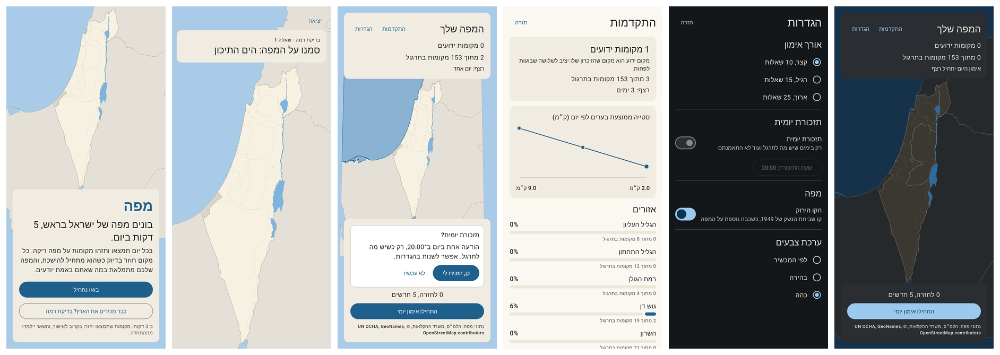
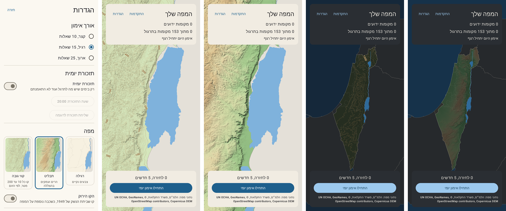
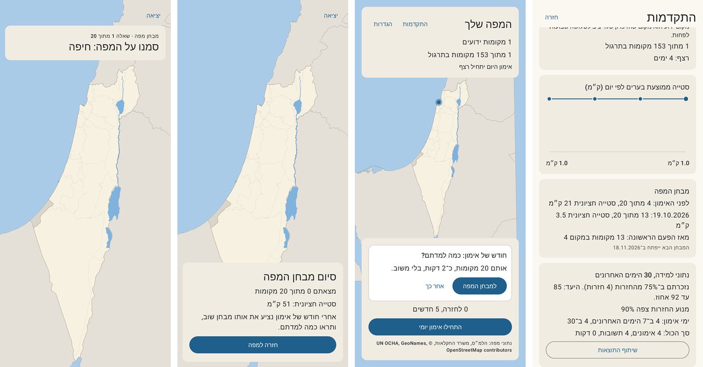

# Mapa (Learn-Israel)

An Android game, in Hebrew, that teaches the geography of Israel, built on the science of how
people actually remember.

> **Status:** Phase 1 in progress. A daily session on a blank map with 153 places
> (the frame, 19 natural regions, 7 districts and 118 cities and towns): find them,
> name them (choice, then typed), and relate them ("which is further north?"),
> scheduled by spaced repetition (FSRS). Onboarding with a placement test, a progress
> screen with region percentages, a daily streak and reminder, settings, and dark
> mode. A 20-place map test before the first session and a month later, and local
> learning stats you can share. Three map styles: standard, shaded relief and
> contour lines. See the [roadmap](docs/09-roadmap.md).

## Install on your phone

**[Download the latest Mapa APK](https://github.com/shavei/Learn-Israel/releases/download/latest-build/mapa.apk)**

This link always points to the newest build of `main`; CI republishes it on every merge.
Open it on an Android phone (8.0 or newer) and allow installing from your browser when
asked. Installing a newer build updates the app and keeps your progress.







## The idea in one paragraph

Your own map of Israel starts gray. Each day a 5 to 10 minute session asks you to
find and name places on a blank map. Every answer gets instant spatial feedback (a
line from your tap to the true spot, the distance in km, and one memorable fact). A
spaced repetition scheduler (FSRS) brings each place back right before you would
forget it. Places you master light up on your map; places you neglect slowly fade.
You learn the big frame first (coast, seas, neighbors, the big three cities), then
regions, then the cities and towns inside them, then nature, roads, and heritage
sites.

## Why it will work

The design is built on the most robust findings in learning science:

| Principle | How the game uses it |
|-----------|----------------------|
| Retrieval practice | Every turn is a recall attempt on a blank map, not reading |
| Spacing | FSRS schedules each place at the moment it is about to be forgotten |
| Feedback and learning from errors | Line, distance, fact after every answer; misses come back in the same session |
| Hierarchical spatial memory | Frame first, anchors next, detail last; every place taught relative to an anchor |
| Interleaving | Confusable places (Ramat Gan / Givatayim, Kiryat Gat / Kiryat Malakhi) are mixed on purpose |
| Optimal difficulty (~85% success) | Session composer adjusts new material to keep success in the sweet spot |
| Dual coding | Name + location + one fact for every place |
| Self-determination theory | The trophy is your own mastery map, honest and earned |

## The plan

| Doc | Contents |
|-----|----------|
| [01. Learning science](docs/01-learning-science.md) | The research, and the 10 design rules derived from it |
| [02. Game design](docs/02-game-design.md) | Vision, players, core loop, modes, progression, motivation |
| [03. Content and curriculum](docs/03-content-curriculum.md) | Tiers, units, item model, ordering, border policy |
| [04. Learning engine](docs/04-learning-engine.md) | FSRS, grading taps by distance, session composer, confusables |
| [05. Technical architecture](docs/05-technical-architecture.md) | Kotlin + Compose stack, modules, custom map renderer, testing |
| [06. Map data](docs/06-map-data.md) | Data sources, licenses, pipeline, validation |
| [07. UX, accessibility, localization](docs/07-ux-accessibility-localization.md) | Onboarding, screens, a11y, Hebrew-only RTL |
| [08. Measurement](docs/08-measurement.md) | How we prove people learn; experiments; privacy |
| [09. Roadmap](docs/09-roadmap.md) | Phases with exit tests and the first sprint |
| [10. Decisions and risks](docs/10-risks-and-open-questions.md) | Decisions made, and how we handle risks |
| [References](docs/references.md) | Papers, algorithms, data sources |

## Project layout

| Path | What it is |
|------|------------|
| `app/` | Android app (Kotlin, Jetpack Compose, Room): map renderer, onboarding, home, session, progress and settings screens, daily reminder |
| `core/geo/` | Pure Kotlin geometry on the Israeli TM grid: distances, point in polygon, shapes |
| `core/content/` | Place and map models, parser for the generated assets |
| `core/learning/` | FSRS scheduler (port of py-fsrs), tap grading, session engine, placement test, pre/post map test, learning stats, mastery and region scores, streak |
| `content/places.yaml` | The curriculum: which places are taught, with Hebrew names, hints and facts |
| `content/regions.yaml` | Which official natural regions make up each of the game's 19 regions |
| `content/natural_regions.geojson` | Official natural regions (CBS; Ministry of Agriculture for Judea and Samaria): the land's outline, the regions and the districts |
| `content/localities.csv` | CBS locality file: official points of the cities and towns |
| `content/jordan_river.geojson` | The Jordan River from OpenStreetMap |
| `content/elevation_detail.bin`, `content/elevation.json` | Ground height on a 100 m grid around Israel (Copernicus DEM GLO-90); the pipeline cuts it to Israel's land for the relief and topographic styles |
| `tools/fetch_sources.py` | Refreshes the source files in `content/` |
| `content/surroundings.geojson`, `content/palestine.geojson` | Coastlines, neighbors and the Dead Sea (OpenStreetMap); Gaza and the Green Line (UN OCHA) |
| `tools/build_content.py` | Data pipeline: the files above + `places.yaml` into `app/src/main/assets/` |

## Build and test

Requirements: JDK 17+, Android SDK with platform 35 (set `sdk.dir` in `local.properties`
or `ANDROID_HOME`).

```bash
./gradlew test                 # all unit tests, plus Robolectric screen tests
./gradlew :app:assembleDebug   # APK at app/build/outputs/apk/debug/app-debug.apk
```

The screen tests save screenshots of a real session to `app/build/screenshots/`.

To change what is taught, edit `content/places.yaml` and regenerate the assets:

```bash
pip install -r tools/requirements.txt
python3 tools/build_content.py
```

CI checks that the committed assets match the pipeline output.

## Data credits

Israel's outline, natural regions, districts and city and town locations from the Israel
Central Bureau of Statistics (natural regions 2018, locality file 2023); natural regions of
Judea and Samaria from the Ministry of Agriculture. Gaza and the Green Line from UN OCHA
(CC BY-IGO). Coastlines, neighboring countries, the Dead Sea, the Jordan River and the
location of Jericho © [OpenStreetMap](https://www.openstreetmap.org/copyright) contributors
(ODbL 1.0). Locations of the other Palestinian cities from
[GeoNames](https://www.geonames.org/) (CC BY 4.0). The FSRS scheduler is
ported from [py-fsrs](https://github.com/open-spaced-repetition/py-fsrs) (MIT).
